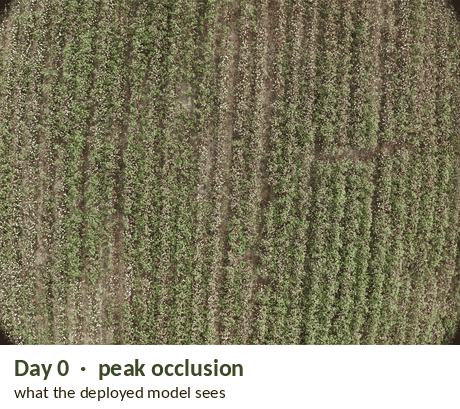
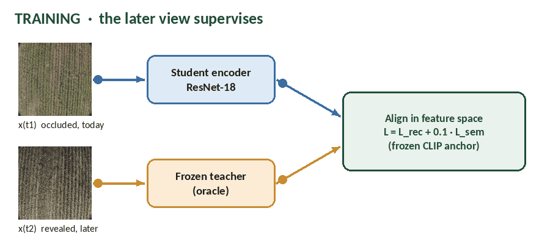
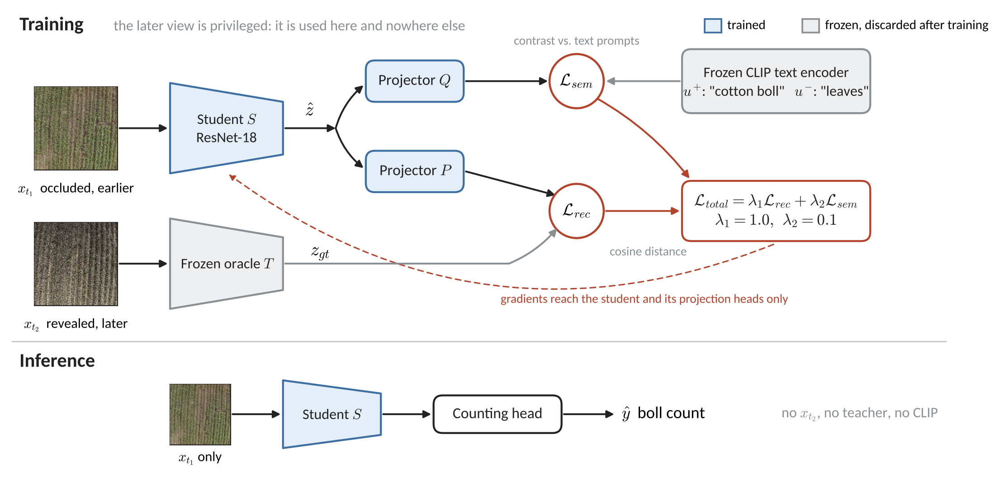
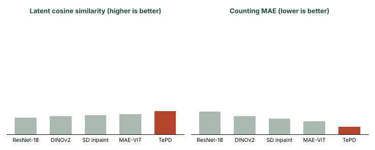
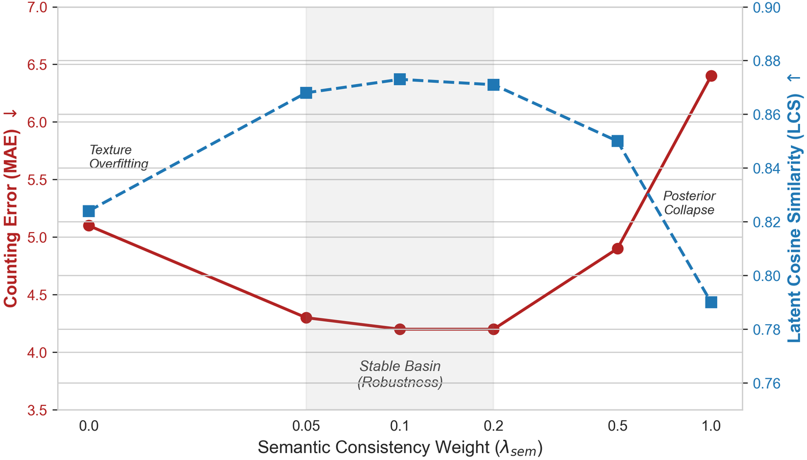
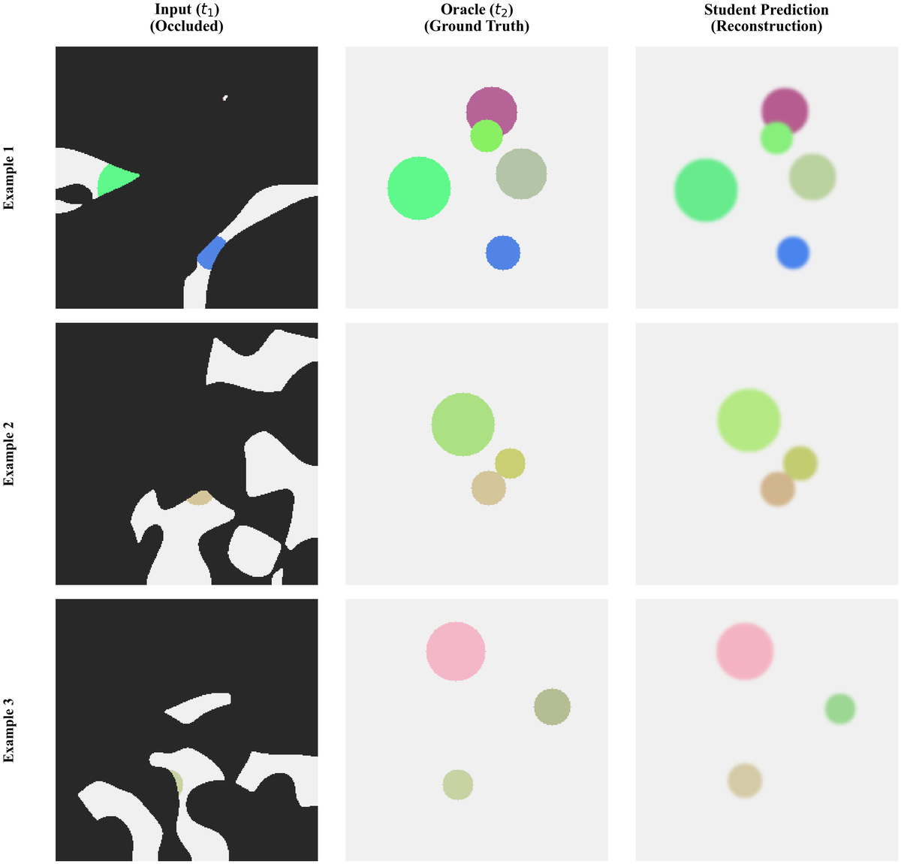
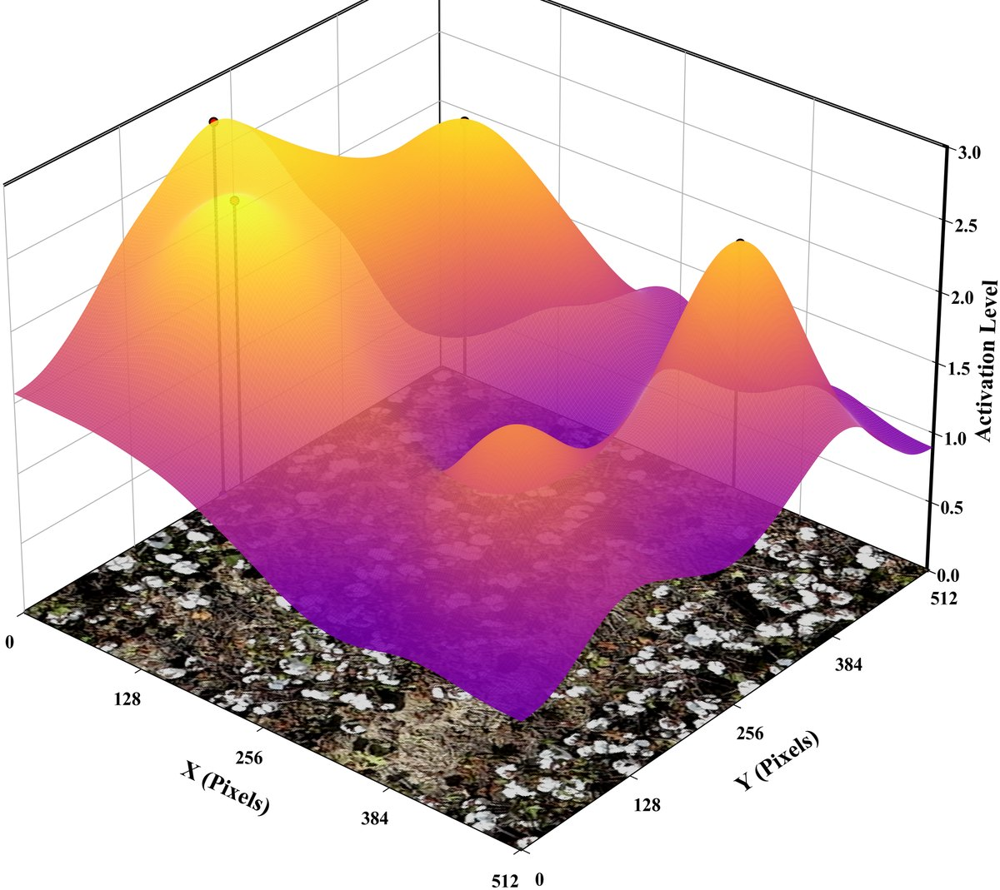

<h1 align="center">TePD: Temporal Privileged Distillation</h1>
<h3 align="center">Amodal counting under structured occlusion</h3>

<p align="center">
  <b>Harshitha Manjunatha</b><sup>1</sup> · Prabha Sundaravadivel<sup>2</sup> · Shekhar Suman Borah<sup>2</sup> · Lakshman Tamil<sup>1</sup> · H. Allen Torbert<sup>3</sup><br>
  <sup>1</sup>The University of Texas at Dallas · <sup>2</sup>The University of Texas at Tyler · <sup>3</sup>USDA Agricultural Research Service
</p>

<p align="center">
  
  
  
</p>

<p align="center">
  <a href="https://harshitha-8.github.io/WIML_NeurIPS2026/"><b>Project page</b></a> ·
  <a href="https://github.com/harshitha-8/DEV-AI_2026"><b>Companion: the developmental view (DevAI)</b></a>
</p>

<p align="center">
  
  &nbsp;
  
</p>

> **Train with the revealed future. Deploy on the occluded present.**
> A later, less-occluded view of the same scene supervises a student network that only ever sees the occluded image.

---

## In one paragraph

Most amodal vision methods treat occlusion as a spatial distortion to complete or inpaint. TePD asks a different question: when visibility changes over time, can that change itself teach a model what stays geometrically fixed? We pair an occluded view `x_t1` with a registered later view `x_t2` of the same location and use the later view as **privileged information**, available during training and absent at test time. A frozen teacher encodes the revealed view, a lightweight student encodes the occluded one, and the student is trained to match the teacher in feature space. At deployment the teacher is gone. On 3,000 paired UAV scenes, the student reaches **0.873** latent cosine similarity and **4.2** counting MAE, against 0.745 and 7.2 for the strongest baseline we evaluated.

## Why this problem

- Counting objects that are mostly hidden is a measurement problem, not an image-synthesis problem. A plausible completion can add or remove objects.
- Human-drawn amodal labels are expensive, and artificial masks do not look like real occluders.
- Many scenes reveal themselves on their own schedule. In cotton, chemical defoliation removes the leaf canopy over several days while the bolls stay approximately in place. The later image contains exactly the information the earlier image lacks.

## The idea

| | Conventional pairing | TePD |
|---|---|---|
| Two views are | interchangeable augmentations | ordered: one is strictly more informative |
| Supervision comes from | labels or masked pixels | a later observation of the same scene |
| What is transferred | pixels or labels | a representation |
| Needed at test time | the same inputs as training | the occluded view only |

## How it works

<p align="center"></p>
<p align="center"><i>TePD training and inference. A frozen oracle encodes the revealed view; the student and its two projectors are the only trained parts. At inference the student and a counting head run on the occluded view alone.</i></p>

With student features $\hat z = S(x_{t_1})$ and teacher features $z_{gt} = T(x_{t_2})$:

$$\mathcal{L}_{rec} = 1 - \cos\big(P(\hat z),\, z_{gt}\big), \qquad \mathcal{L}_{total} = \lambda_1 \mathcal{L}_{rec} + \lambda_2 \mathcal{L}_{sem}, \quad \lambda_1 = 1.0,\ \lambda_2 = 0.1$$

- **Geometric term.** Projector `P` maps student features into the frozen teacher's space; cosine distance aligns them.
- **Semantic term.** A second projector `Q` maps student features into the frozen CLIP text space, where the loss favors the prompt "cotton boll" over "leaves". It keeps the student from locking onto persistent background structure.
- **Independent projectors.** `P` and `Q` are separate. We do not assume CLIP embeddings and teacher features are comparable.
- **Nothing privileged survives training.** The teacher and CLIP are discarded; a ResNet-18 student and a counting head are all that run.

## Cotton-TePD benchmark

- **3,000** registered 512×512 UAV image pairs captured before and after chemical defoliation: a real time-revealing reference, not a synthetic one.
- Pairs corrected for 1-2 m platform drift with SIFT keypoints and RANSAC homographies.
- **2,500** training pairs and **500** test pairs.
- **LCS** (latent cosine similarity) scores representation quality, always in the same evaluation space. **MAE** scores counting with the encoder frozen and a basic regression head, so the comparison isolates the representation from the counting model.

## Results

<p align="center"></p>

| Method | Learning signal | LCS ↑ | Counting MAE ↓ |
|---|---|:---:|:---:|
| ResNet-18 | direct supervision | 0.621 | 12.4 |
| DINOv2 | zero-shot features | 0.684 | 9.8 |
| Stable Diffusion | inpainting | 0.712 | 8.5 |
| MAE-ViT | masked reconstruction | 0.745 | 7.2 |
| **TePD (ours)** | **temporal privilege** | **0.873** | **4.2** |

Against the strongest baseline (MAE-ViT), TePD improves LCS by **17.2%** and reduces counting MAE by **41.7%**. Across the three study regions the numbers barely move (LCS 0.871 / 0.875 / 0.869, MAE 4.1 / 4.3 / 4.2), which argues against a place-specific effect.

## Controls

<table>
<tr>
<td width="50%"></td>
<td width="50%"></td>
</tr>
<tr>
<td><b>The semantic anchor matters.</b> Removing it lowers LCS from 0.87 to 0.82. The default weight of 0.1 sits in a stable range; over-weighting the term hurts both metrics.</td>
<td><b>Not only cotton texture.</b> On a texture-free synthetic task, TePD reaches LCS 0.972 while direct supervised regression reaches 0.64. This number comes from a different setup than the 0.873 above and should not be compared with it directly.</td>
</tr>
</table>

<p align="center"></p>
<p align="center"><i>Spatial magnitude of the student's features over an occluded input. Peaks line up with several boll locations visible only in the later view. This is descriptive; held-out counting error is the test.</i></p>

## Scope and limitations

- TePD targets sequences where occlusion decreases over time and the target keeps its form. It has been validated on cotton only.
- Homography corrects platform drift but not irregular motion. Wind above 15 mph produces 5-10 cm displacements in about 2% of cases, and shadows can imitate a newly visible feature.
- Partial or uneven revelation and dynamic scenes have not been evaluated.

## Beyond the cotton field

Nothing in the objective is specific to crops. The method needs three conditions:

1. two registered observations of one scene,
2. occlusion that decreases between them,
3. object identity that persists across the interval.

Settings that plausibly meet them include snow melt, tidal recession, staged assembly and repeated robot interaction. None of these has been tested; each would need evidence that the later view shows the same instances.

## At NeurIPS 2026

| | |
|---|---|
| Event | Women in Machine Learning (WiML) Workshop at NeurIPS 2026 |
| Where | Georgia World Congress Center, Atlanta, GA |
| When | December 9, 2026 (see the WiML schedule for session times) |

## Repository

```
docs/            project page (served by GitHub Pages)
docs/assets/     figures and animations
```

This repository currently hosts the project page and figures. Code and the Cotton-TePD data are not included here yet.

## Citation

```bibtex
@inproceedings{manjunatha2026tepd,
  title     = {TePD: Temporal Privileged Distillation for Amodal Counting Under Structured Occlusion},
  author    = {Manjunatha, Harshitha and Sundaravadivel, Prabha and Borah, Shekhar Suman and Tamil, Lakshman and Torbert, H. Allen},
  booktitle = {Women in Machine Learning (WiML) Workshop at NeurIPS},
  year      = {2026}
}
```

## Acknowledgments and contact

This work was funded by USDA-ARS NACA: 58-6010-4-007. The views expressed are those of the authors and do not necessarily reflect USDA-ARS.

Contact: harshitha.manjunatha@utdallas.edu

The same study is presented from a developmental-learning angle at the DevAI workshop: [Learning Object Permanence from Natural Revealing Events](https://github.com/harshitha-8/DEV-AI_2026).
